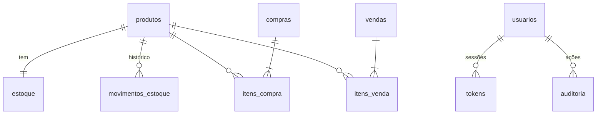

# Sistema de Vendas e Estoque

Sistema criado a partir do relatório *Módulos, Componentes e Plano de Testes*.
Feito em **Python + Flask + SQLite**, com tela web em português.

## Como rodar

```bash
pip install -r requirements.txt
python run.py
```

Abra http://127.0.0.1:5000 e entre com o usuário Admin criado automaticamente:

| E-mail | Senha inicial |
|---|---|
| admin@sistema.com | admin123 |

**No primeiro login o sistema obriga a troca da senha.** Para já começar com outra senha, defina `ADMIN_SENHA` antes da primeira execução.

Os dados ficam em `dados/` (banco `sistema.db`, `sistema.log` e a chave das sessões). Para zerar o sistema, apague essa pasta.

### Configuração (variáveis de ambiente — veja `.env.example`)

| Variável | Para que serve |
|---|---|
| `SECRET_KEY` | chave das sessões. Se faltar, o `run.py` cria uma e guarda em `dados/chave_secreta` |
| `HOST`, `PORT` | onde escutar (padrão `127.0.0.1:5000`) |
| `COOKIE_SEGURO=1` | use quando o sistema estiver atrás de HTTPS |
| `ADMIN_SENHA` | senha inicial do Admin |
| `DADOS_DIR` | pasta do banco, logs e chave (padrão `./dados`) |

O `run.py` usa o **waitress** (servidor de produção) quando ele está instalado; sem ele, cai no servidor de desenvolvimento do Flask.

### Docker

```bash
docker build -t vendas-estoque .
docker run -p 5000:5000 -v vendas_dados:/dados -e SECRET_KEY=troque-isto vendas-estoque
```

### Backup

```bash
python scripts/backup.py        # copia dados/sistema.db para dados/backups/ (guarda as 14 últimas)
```

## O que o sistema faz (especificações da atividade)

| # | Requisito | Onde está |
|---|---|---|
| 1 | Tela de Login | `/login` |
| 2 | Usuário Admin | perfil `admin`; só ele cadastra/remove usuários e produtos |
| 3 | Cadastro de usuário (Nome completo, ID, E-mail, Telefone) | `/usuarios` |
| 4 | Remoção de usuário | `/usuarios` (botão Remover) |
| 5 | Cadastro de produtos (3 tipos) | `/produtos` — Alimento, Eletrônico, Vestuário |
| 6 | Remoção de produtos | `/produtos` (botão Remover) |
| 7 | Compra e Venda | `/compras` e `/vendas` |
| 8 | Atualização de estoque | automática na compra, venda e cancelamento; consulta em `/estoque` |
| extra | Catálogo de produtos disponíveis | `/catalogo`: cartões só dos produtos com estoque, filtro por tipo e botão "Vender" que já escolhe o produto na tela de venda |

Perfis: **Admin** faz tudo; **Comum** compra, vende e consulta o estoque.

### Recursos acrescentados na versão revisada

| Área | O que tem |
|---|---|
| Painel (`/`) | vendido hoje e no mês, valor em estoque, produtos abaixo do mínimo, mais vendidos |
| Produtos | **edição** (nome, tipo, preço) e **estoque mínimo** com alerta; remoção com confirmação |
| Compras e vendas | **vários produtos na mesma operação** (botão "+ Adicionar outro produto"), paginação |
| Estoque | situação (Normal / Abaixo do mínimo / Sem estoque) e **histórico de movimentos** por produto |
| Relatórios (Admin) | vendas por período, mais vendidos, **exportação CSV** (vendas e estoque, abre direto no Excel) |
| Auditoria (Admin) | quem fez o quê e quando: logins, falhas de login, cadastros, remoções, vendas, cancelamentos |
| Conta | troca de senha (exige a atual; derruba as outras sessões) |

### Segurança

- **CSRF**: todo formulário `POST` leva um token; pedidos sem ele são recusados (HTTP 400).
- **Limite de tentativas de login**: 5 erros por e-mail em 5 minutos bloqueiam novas tentativas (HTTP 429).
- **Senhas**: PBKDF2-SHA256 com 600 mil voltas; hashes antigos continuam valendo e são atualizados no próximo login.
- **Sessão**: cookie `HttpOnly` + `SameSite=Lax` (+ `Secure` com `COOKIE_SEGURO=1`); tokens vencidos são limpos do banco.
- **Cabeçalhos**: `Content-Security-Policy` restritiva (sem scripts nem estilos embutidos), `X-Frame-Options`, `nosniff`, `no-store`.
- **Admin padrão**: troca de senha obrigatória no primeiro login; `SECRET_KEY` nunca é um valor fixo do código.
- **CSV**: células que começam com `=`, `+`, `-` ou `@` são neutralizadas contra injeção de fórmula.

### Integridade dos dados

- Chaves estrangeiras ligadas (`PRAGMA foreign_keys`) e índices nas tabelas de itens e movimentos.
- **Exclusão lógica de produtos** (`ativo = 0`): somem das telas, mas o histórico de compras, vendas e movimentos continua íntegro.
- Transações `BEGIN IMMEDIATE`: conferir e baixar o estoque acontecem juntos, então duas vendas simultâneas nunca vendem a mesma unidade (há teste de concorrência com threads e com duas conexões).
- Bancos de versões anteriores são atualizados sozinhos na abertura (novas colunas e índices), sem perder dados.

## Módulos, classes, métodos e funções (como no relatório)

Os nomes seguem o relatório, escritos em `snake_case` (padrão do Python): `buscarPorNome()` virou `buscar_por_nome()`.

| Módulo (pasta em `sistema/`) | Classes e métodos | Funções |
|---|---|---|
| `autenticacao` | **Autenticador**: `login`, `logout`, `validar_senha` · **Sessao**: `gerar_token`, `validar_token` | `comparar_senha`, `token_expirado` |
| `usuarios` | **Usuario**: `cadastrar`, `listar`, `buscar_por_id`, `remover` · **Perfil**: `eh_admin`, `listar_permissoes` | `validar_email`, `validar_telefone` |
| `produtos` | **Produto**: `cadastrar`, `listar`, `buscar_por_nome`, `remover` · **TipoProduto**: `listar`, `validar_tipo` | `validar_dados`, `salvar_no_banco` |
| `compra_venda` | **Compra**: `registrar`, `listar`, `calcular_total` · **Venda**: `registrar`, `calcular_total`, `cancelar` | `validar_itens`, `calcular_subtotal` |
| `estoque` | **Estoque**: `consultar_quantidade`, `verificar_disponibilidade`, `atualizar` · **MovimentoEstoque**: `registrar`, `listar_por_produto` | `calcular_nova_quantidade` |

Limites de entrada: quantidade máxima de 1.000.000 por item e preço máximo de R$ 1.000.000,00 (valores maiores são recusados com mensagem, sem erro 500).

Acréscimos além do relatório, necessários para o sistema funcionar: `Perfil.tem_permissao`, `Produto.buscar_por_id`, `Produto.editar`, `Compra/Venda.buscar_por_id`, `Compra/Venda.listar(limite, deslocamento)`, `Estoque.listar`, `Estoque.listar_abaixo_do_minimo`, `Estoque.criar_registro/remover_registro`, `Usuario.alterar_senha`, `Sessao.limpar_expirados` e a função `gerar_hash_senha`. Também novos: `Auditoria`, `Relatorios` e `LimitadorLogin`.

## Testes

Usam apenas o `unittest` do Python (nada para instalar).

```bash
python executar_testes.py                # tudo (220 testes)
python executar_testes.py unitarios
python executar_testes.py integracao
python executar_testes.py sistema
python executar_testes.py aceitacao
python executar_testes.py regressao      # reexecuta unitários + integração + regressão
```

| Tipo de teste | Pasta | Responsável (relatório, seção 7) |
|---|---|---|
| Unitário | `tests/unitarios/` | cada um nos seus módulos: Antonio (autenticação, usuários), Arthur (produtos, estoque), Laerte (compra e venda) |
| Integração | `tests/integracao/` | Antonio (login/banco, token, usuários), Arthur (produtos × estoque), Arthur + Laerte (compra/venda × produtos e estoque) |
| Sistema | `tests/sistema/` | Laerte |
| Aceitação | `tests/aceitacao/` | Um roteiro por requisito, dividido: Antonio (REQ-01 a 04), Arthur (REQ-05, 06 e 08), Laerte (REQ-07) |
| Regressão | `tests/regressao/` | Arthur coordena; quem corrige um erro avisa a equipe e o Arthur roda `python executar_testes.py regressao` |
| Alfa e Beta | `docs/roteiro_testes_alfa_beta.md` | Arthur coordena e reúne os resultados; alfa: cada um nos fluxos dos seus módulos; beta: cada um convida 1 pessoa de fora |
| Automação (macro) | `automacao/macro_selenium.py` | Antonio (login, usuários), Arthur (produtos, estoque), Laerte (compra e venda) |

Com cobertura e verificação de estilo (`pip install -r requirements-dev.txt`):

```bash
coverage run executar_testes.py && coverage report
ruff check .
```

Os testes novos estão em `tests/unitarios/test_seguranca.py`, `tests/unitarios/test_melhorias_dados.py` e `tests/integracao/test_melhorias_web.py`. A cada *push*, o GitHub Actions (`.github/workflows/ci.yml`) roda o lint e todos os testes em Python 3.10, 3.12 e 3.13.

### Automação com Selenium

```bash
pip install selenium
python automacao/macro_selenium.py            # abre o Chrome e repete as ações sozinho
HEADLESS=1 python automacao/macro_selenium.py # sem abrir a janela
PAUSA=1 python automacao/macro_selenium.py    # mais devagar, para apresentar
```

Precisa do Google Chrome instalado (o Selenium baixa o driver sozinho). A macro sobe uma cópia própria do sistema com banco em memória, sem mexer nos seus dados.

## Estrutura

```
run.py                  inicia o sistema (waitress, logs, chave de sessão)
executar_testes.py      roda as suítes de teste
sistema/                código (um pacote por módulo + app.py, banco.py, erros.py ...)
  web/                  rotas (um blueprint por área: auth, usuarios, produtos, operacoes, estoque, relatorios, painel)
  templates/ static/    telas, estilo e JavaScript
  auditoria.py  relatorios.py  limitador.py
tests/                  testes unitários, integração, sistema, aceitação e regressão
automacao/              macro Selenium/Python
scripts/backup.py       cópia de segurança do banco
docs/                   roteiro dos testes alfa e beta
Dockerfile  pyproject.toml  requirements*.txt  .env.example  .github/workflows/ci.yml
```

### Modelo do banco



### O que ainda pode evoluir

- Valores em dinheiro estão em `REAL`; para contabilidade rigorosa, guardar em centavos (inteiro) ou `Decimal`.
- Cadastro de clientes e fornecedores ligados às vendas e compras.
- Migrações versionadas (Alembic) se o esquema crescer bastante.
